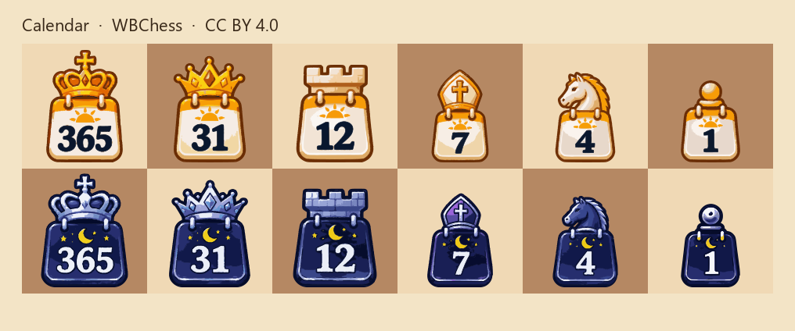
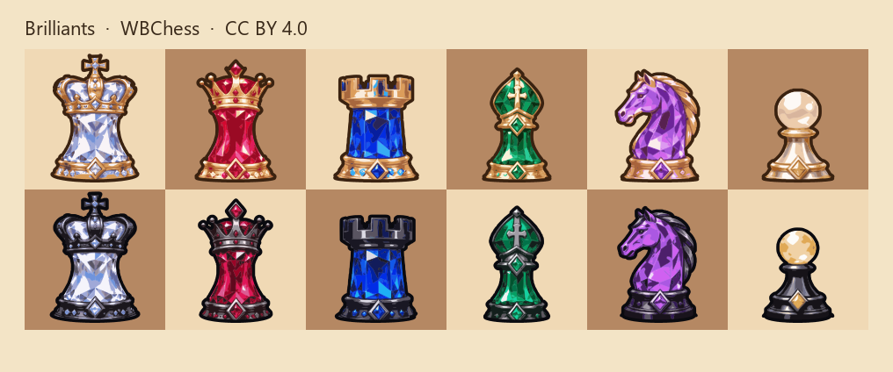

# WBChess chess pieces

Vector chess piece sets, one folder per set: [Halloween](#halloween), [Calendar](#calendar), [Knights and Dragons](#knights-and-dragons), [Brilliants](#brilliants).

Each set has twelve pieces. Each file is an SVG with `viewBox="0 0 40 40"`, already fitted to the square. File names are the same in every set: `wK.svg` … `bP.svg`.

In every preview the top rank is white and the bottom rank is black. Left to right: king, queen, rook, bishop, knight, pawn.

## License

**CC BY 4.0.** You may use, change, and ship these pieces, including in commercial work. Credit the author, link to the license, and note it if you change the files.

Legal code: [Creative Commons Attribution 4.0](https://creativecommons.org/licenses/by/4.0/legalcode). Summary: [deed.en](https://creativecommons.org/licenses/by/4.0/deed.en).

Suggested credit, with the name of the set you use:

> Halloween chess pieces by WBChess, https://wbchess.com, licensed under CC BY 4.0.

Each set folder also has its own `LICENSE` file.

## Halloween

White pieces are pumpkin characters. Black pieces are a count, his bride, a coffin, a cat, a night horse and a mouse.

| File | Piece | Name |
| --- | --- | --- |
| [wK.svg](Halloween/wK.svg) | white king | Halloween Pumpkin King |
| [wQ.svg](Halloween/wQ.svg) | white queen | Halloween Pumpkin Queen |
| [wR.svg](Halloween/wR.svg) | white rook | Halloween Pumpkin Rook |
| [wB.svg](Halloween/wB.svg) | white bishop | Halloween Pumpkin Bishop |
| [wN.svg](Halloween/wN.svg) | white knight | Halloween Pumpkin Knight |
| [wP.svg](Halloween/wP.svg) | white pawn | Halloween Pumpkin Pawn |
| [bK.svg](Halloween/bK.svg) | black king | Halloween Count King |
| [bQ.svg](Halloween/bQ.svg) | black queen | Halloween Bride Queen |
| [bR.svg](Halloween/bR.svg) | black rook | Halloween Coffin Rook |
| [bB.svg](Halloween/bB.svg) | black bishop | Halloween Cat Bishop |
| [bN.svg](Halloween/bN.svg) | black knight | Halloween Night Horse Knight |
| [bP.svg](Halloween/bP.svg) | black pawn | Halloween Mouse Pawn |

## Calendar

Tear-off calendars, day against night. White pieces are cream pages with a rising sun under golden crowns and signs. Black pieces are navy pages with a crescent moon and stars under silver ones. Each page shows a number: king 365 (days in a year), queen 31 (days in the longest month), rook 12 (months), bishop 7 (days in a week), knight 4 (weeks in a month), pawn 1 (one day).

| File | Piece | Name |
| --- | --- | --- |
| [wK.svg](Calendar/wK.svg) | white king | Calendar Day King |
| [wQ.svg](Calendar/wQ.svg) | white queen | Calendar Day Queen |
| [wR.svg](Calendar/wR.svg) | white rook | Calendar Day Rook |
| [wB.svg](Calendar/wB.svg) | white bishop | Calendar Day Bishop |
| [wN.svg](Calendar/wN.svg) | white knight | Calendar Day Knight |
| [wP.svg](Calendar/wP.svg) | white pawn | Calendar Day Pawn |
| [bK.svg](Calendar/bK.svg) | black king | Calendar Night King |
| [bQ.svg](Calendar/bQ.svg) | black queen | Calendar Night Queen |
| [bR.svg](Calendar/bR.svg) | black rook | Calendar Night Rook |
| [bB.svg](Calendar/bB.svg) | black bishop | Calendar Night Bishop |
| [bN.svg](Calendar/bN.svg) | black knight | Calendar Night Knight |
| [bP.svg](Calendar/bP.svg) | black pawn | Calendar Night Pawn |

## Knights and Dragons

Cartoon fantasy: blue-and-silver knights against red-and-black dragons. White has a crowned knight king, a red-haired queen, a white tower, a hooded bishop, a white horse and a young squire. Black has a dragon king and queen, a dark tower with glowing windows, a dragon wizard, a winged dragon and a baby dragon. All pieces stand on round pedestals with golden rims.

| File | Piece | Name |
| --- | --- | --- |
| [wK.svg](Knights%20and%20Dragons/wK.svg) | white king | Knights and Dragons White King |
| [wQ.svg](Knights%20and%20Dragons/wQ.svg) | white queen | Knights and Dragons White Queen |
| [wR.svg](Knights%20and%20Dragons/wR.svg) | white rook | Knights and Dragons White Rook |
| [wB.svg](Knights%20and%20Dragons/wB.svg) | white bishop | Knights and Dragons White Bishop |
| [wN.svg](Knights%20and%20Dragons/wN.svg) | white knight | Knights and Dragons White Knight |
| [wP.svg](Knights%20and%20Dragons/wP.svg) | white pawn | Knights and Dragons White Pawn |
| [bK.svg](Knights%20and%20Dragons/bK.svg) | black king | Knights and Dragons Black King |
| [bQ.svg](Knights%20and%20Dragons/bQ.svg) | black queen | Knights and Dragons Black Queen |
| [bR.svg](Knights%20and%20Dragons/bR.svg) | black rook | Knights and Dragons Black Rook |
| [bB.svg](Knights%20and%20Dragons/bB.svg) | black bishop | Knights and Dragons Black Bishop |
| [bN.svg](Knights%20and%20Dragons/bN.svg) | black knight | Knights and Dragons Black Knight |
| [bP.svg](Knights%20and%20Dragons/bP.svg) | black pawn | Knights and Dragons Black Pawn |

## Brilliants

Every piece is a faceted gemstone: diamond king, ruby queen, sapphire rook, emerald bishop, amethyst knight and pearl pawn. White pieces are set in gold. Black pieces are set in black metal and silver.

| File | Piece | Name |
| --- | --- | --- |
| [wK.svg](Brilliants/wK.svg) | white king | Brilliants White King |
| [wQ.svg](Brilliants/wQ.svg) | white queen | Brilliants White Queen |
| [wR.svg](Brilliants/wR.svg) | white rook | Brilliants White Rook |
| [wB.svg](Brilliants/wB.svg) | white bishop | Brilliants White Bishop |
| [wN.svg](Brilliants/wN.svg) | white knight | Brilliants White Knight |
| [wP.svg](Brilliants/wP.svg) | white pawn | Brilliants White Pawn |
| [bK.svg](Brilliants/bK.svg) | black king | Brilliants Black King |
| [bQ.svg](Brilliants/bQ.svg) | black queen | Brilliants Black Queen |
| [bR.svg](Brilliants/bR.svg) | black rook | Brilliants Black Rook |
| [bB.svg](Brilliants/bB.svg) | black bishop | Brilliants Black Bishop |
| [bN.svg](Brilliants/bN.svg) | black knight | Brilliants Black Knight |
| [bP.svg](Brilliants/bP.svg) | black pawn | Brilliants Black Pawn |

## Diagrams

These links are not a condition of the license. The pages are where the pieces can be placed on a board immediately.

Generate a diagram here: https://wbchess.com/service_fen.php

Animated diagrams: https://wbchess.com/service_anim.php
