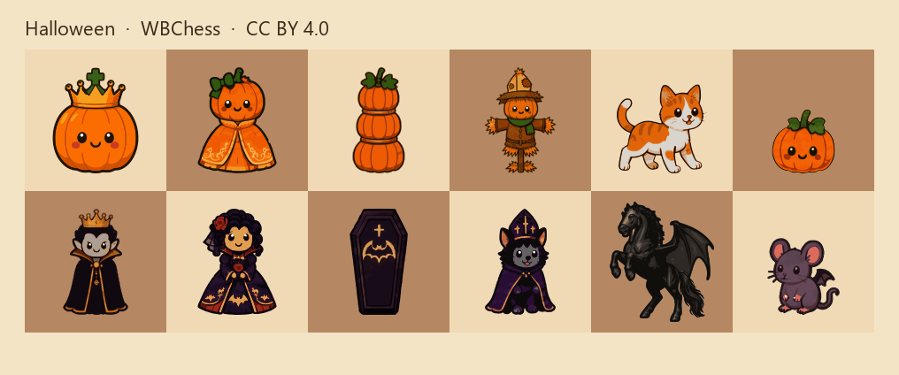

# WBChess chess pieces

Vector chess piece sets. This repository currently contains one set, Halloween. Further sets will be added as sibling folders.

Top rank is white, bottom rank is black. Left to right: king, queen, rook, bishop, knight, pawn.

## License

**CC BY 4.0.** You may use, change, and ship these pieces, including in commercial work. Credit the author, link to the license, and note it if you change the files.

Legal code: [Creative Commons Attribution 4.0](https://creativecommons.org/licenses/by/4.0/legalcode). Summary: [deed.en](https://creativecommons.org/licenses/by/4.0/deed.en).

Suggested credit:

> Halloween chess pieces by WBChess, https://wbchess.com, licensed under CC BY 4.0.

## Halloween

Twelve pieces. Each file is an SVG with `viewBox="0 0 40 40"`, already fitted to the square.

| File | Piece | Name |
| --- | --- | --- |
| [wK.svg](Halloween/wK.svg) | white king | Halloween Pumpkin King |
| [wQ.svg](Halloween/wQ.svg) | white queen | Halloween Pumpkin Queen |
| [wR.svg](Halloween/wR.svg) | white rook | Halloween Pumpkin Rook |
| [wB.svg](Halloween/wB.svg) | white bishop | Halloween Pumpkin Bishop |
| [wN.svg](Halloween/wN.svg) | white knight | Halloween Pumpkin Knight |
| [wP.svg](Halloween/wP.svg) | white pawn | Halloween Pumpkin Pawn |
| [bK.svg](Halloween/bK.svg) | black king | Halloween Count King |
| [bQ.svg](Halloween/bQ.svg) | black queen | Halloween Bride Queen |
| [bR.svg](Halloween/bR.svg) | black rook | Halloween Coffin Rook |
| [bB.svg](Halloween/bB.svg) | black bishop | Halloween Cat Bishop |
| [bN.svg](Halloween/bN.svg) | black knight | Halloween Night Horse Knight |
| [bP.svg](Halloween/bP.svg) | black pawn | Halloween Mouse Pawn |

The set license and the contact sheet are in [Halloween](Halloween/).

## Diagrams

These links are not a condition of the license. The pages are where the pieces can be placed on a board immediately.

Generate a diagram here: https://wbchess.com/service_fen.php

Animated diagrams: https://wbchess.com/service_anim.php
